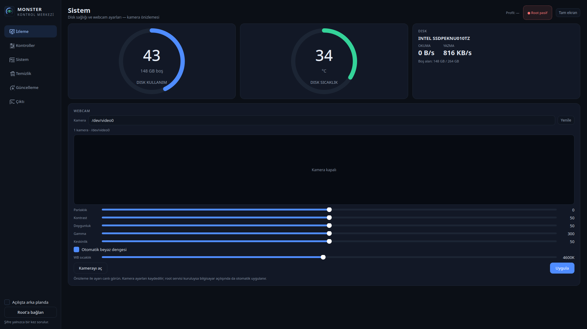
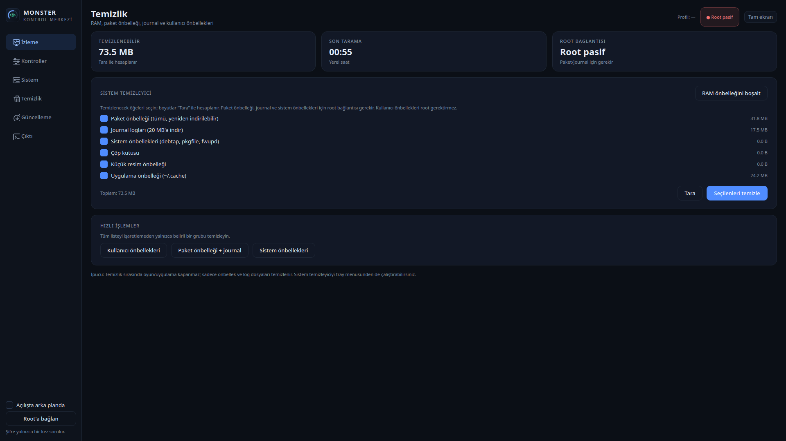

<p align="center">
  
</p>

<h1 align="center">OpenMonster</h1>
<p align="center"><b>Monster / Uniwill laptoplar için Linux kontrol merkezi</b><br>
Fan eğrisi · klavye RGB · webcam · batarya limiti · CPU güç limitleri · GitHub güncellemeleri</p>

<p align="center">
  
  
  
</p>

OpenMonster, Monster/Abra (Uniwill/Tongfang ODM) laptopları Linux'ta yönetmek için
yazılmış açık kaynak bir kontrol merkezidir. Gerçek donanım (EC/BIOS) üzerinden
çalışır; sanal veya "kaplivada" bir katman değildir. Modern PyQt6 arayüzü ve
`monsterctl` CLI aracı aynı çekirdeği kullanır.


## Özellikler

- **Canlı izleme:** CPU/GPU sıcaklığı, frekans ve güç; NVIDIA GPU yükü/belleği;
  fan devri ve duty; RAM; disk sağlığı/sıcaklığı/okuma-yazma; batarya; PL1/PL2/PL4.
- **Fan kontrolü:** EC universal fan tablosu (`0x0F00..0x0F5F`) + doğrudan
  `0x1804` / `0x1809` yazımı. CPU/GPU fanını ayrı ayrı veya birlikte sürme.
- **Fan profilleri (Profil 2.0):** Sessiz / Dengeli / Performans hazır gelir.
  Kontroller ekranından **＋ Yeni** ile ad, sabit fan hızı veya sıcaklık
  eğrisi, güç limiti, ekran parlaklığı, CPU governor/EPP, maksimum frekans ve
  çekirdek sayısı içeren profiller oluşturun. Profillere sağ tıklayıp
  düzenleyin/silin. Profiller `~/.config/openmonster/profiles.json` içinde
  saklanır.
- **Fan eğrisi editörü:** Sürüklenebilir noktalarla sıcaklık→fan eğrisi.
  Eğri, en sıcak CPU/GPU sensörüne göre 3 saniyede bir uygulanır; 70 °C
  üstünde güvenlik için en az %40 fan zorunludur.
- **AC/pil otomasyonu ve kalıcı ayarlar:** Profillere “AC” ve/veya “pil” atayın;
  güç kaynağı değiştiğinde uygun profil otomatik uygulanır. Ayrıca son yaptığınız
  fan, güç, parlaklık, CPU ve webcam ayarları kaydedilir; `monster-ctrl-profile`
  root servisi bunları **bilgisayar her açıldığında** siz değiştirene kadar
  otomatik uygular. Bu, TCC’nin kalıcı profil davranışına karşılık gelir.
- **Sistem tepsisi:** Pencereyi kapatmak uygulamayı kapatmaz; arka planda
  çalışır. Tepsi menüsünden uygulamayı açmadan RAM/sistem temizleyebilir,
  klavye rengi ve animasyonu seçebilir, fan profili uygulayabilirsiniz.
- **GitHub güncellemeleri:** Kenar çubuğundaki **Güncelleme** sayfası GitHub
  Releases API’sinden son sürümü denetler. Açılışta sessiz denetim varsayılan
  olarak açıktır; yeni sürüm varsa menüde işaretlenir. Dağıtımınıza uygun
  `.deb`, `.rpm`, Arch paketi veya portable arşiv seçilir, indirilen dosya
  `SHA256SUMS-linux` ile doğrulanır ve `pkexec` ile kurulur. Kurulumdan sonra
  tek tıkla yeniden başlatabilirsiniz.
- **Klavye RGB:** Renk seçici + 6 animasyon (gökkuşağı, nefes, kalp atışı,
  ateş, renk geçişi, çakar).
- **Batarya:** Şarj limiti (%10–100 veya kapalı) ve hazır profiller:
  Tam / Dengeli %90 / Sabit %80.
- **CPU güç limitleri:** intel-rapl üzerinden PL1/PL2/PL4.
- **CPU performans:** governor (performance/powersave), EPP, maksimum frekans
  yüzdesi ve çevrimiçi çekirdek sayısı; CLI ve profillerden yönetilebilir.
- **Ekran:** Parlaklık kontrolü ve profil bazında parlaklık. (Yenileme hızı
  Wayland'da taşınabilir değil; GPU geçişi MUX olmadığı için kapsam dışı.)
- **Webcam:** `v4l2-ctl` üzerinden parlaklık, kontrast, doygunluk, gamma,
  keskinlik ve beyaz dengesi (otomatik veya Kelvin) denetimi. **Kamerayı aç**
  ile canlı önizleme yapın; görüntü yalnızca webcam sayfasındayken açık kalır.
  Seçilen kamera ve değerler kaydedilir; root servisi açılışta yeniden uygular.
- **Sistem temizleyici:** paket önbelleği, journal, sistem önbellekleri, çöp
  kutusu, küçük resimler ve uygulama önbelleği.
- **Tam ekran:** F11 ile tam ekran, Esc ile çıkış. Göstergeler her çözünürlükte
  kartların içinde kalacak şekilde ölçeklenir.
- **Tek şifre:** Açılışta bir kez `pkexec` parolası sorulur; root yardımcı
  süreci oturum boyunca komutları parolasız çalıştırır.






## Kurulum

Hazır paketler [GitHub Releases](https://github.com/talhayksk/openmonster/releases/latest)
sayfasında. Paketler; `/usr/bin/openmonster`, `/usr/bin/monsterctl`, uygulama menü
kaydı, ikonlar, modprobe/modules-load yapılandırması ve kalıcı otomatik ayar
systemd servisini (`monster-ctrl-profile.service`) kurar.

### Arch Linux / CachyOS (pacman)

```bash
sudo pacman -U openmonster-1.1.0-1-x86_64.pkg.tar.zst
openmonster
```

AUR paket dosyaları [`packaging/aur`](packaging/aur) altında hazır. AUR hesap
kaydı yeniden açıldığında paket AUR'a gönderilecek:

```bash
yay -S openmonster        # veya paru -S openmonster
```

### Debian / Ubuntu (.deb)

```bash
sudo apt install ./openmonster_1.1.0-1_amd64.deb
openmonster
```

Debian 12 ve Ubuntu 24.04 üzerinde test edildi. Eski `apt` sürümlerinde:

```bash
sudo dpkg -i openmonster_1.1.0-1_amd64.deb
sudo apt -f install
```

### Fedora / RPM tabanlı dağıtımlar (.rpm)

```bash
sudo dnf install ./openmonster-1.1.0-1.fc41.x86_64.rpm
openmonster
```

Fedora 41 üzerinde test edildi. `acpi_call` ve NVIDIA sürücüsü Fedora'da
genellikle RPM Fusion'dan gelir; paket bunları yalnızca önerir, zorunlu tutmaz.

### Diğer dağıtımlar (portable arşiv)

```bash
tar -xzf openmonster-1.1.0-portable-x86_64.tar.gz
cd openmonster-1.1.0-portable
sudo ./install.sh
openmonster
```

Portable arşiv, C yardımcısını statik olarak içerir; Python 3 + PyQt6, PolicyKit
(`pkexec`), `kmod` ve `systemd` sistemde bulunmalıdır. Kaldırmak için aynı
dizinde:

```bash
sudo ./uninstall.sh
```

### Kaynaktan

```bash
git clone https://github.com/talhayksk/openmonster.git
cd openmonster
make
sudo make install
openmonster
```

`make install` varsayılan olarak `/usr` altına kurar. Farklı bir yere kurmak
için `PREFIX` ve `DESTDIR` kullanılabilir.

## Güncelleme

Kenar çubuğundaki **Güncelleme** sayfası, GitHub’daki en son sürümü denetler.
Açılışta otomatik kontrol varsayılan olarak açıktır; kapatmak için sayfadaki
**Açılışta otomatik kontrol et** kutusunu kullanın. Yeni sürüm bulunduğunda
menüde `Güncelleme •` olarak işaretlenir.

- Dağıtımınıza uygun paket otomatik seçilir: `.deb`, `.rpm`, Arch
  `.pkg.tar.zst` veya portable `.tar.gz`.
- İndirme sonrası dosya `SHA256SUMS-linux` ile doğrulanır; doğrulama başarısızsa
  kurulum yapılmaz.
- Kurulum `pkexec` ile dağıtımın paket yöneticisini kullanır. Yönetici parolası
  yalnızca bu adımda istenir.
- Kurulum tamamlandığında **Yeniden başlat** düğmesi görünür.

### Gereksinimler

- Python 3 + PyQt6
- `acpi_call` çekirdek modülü (fan/batarya EC erişimi)
- `uniwill-laptop` çekirdek modülü (`force=1`)
- NVIDIA istatistikleri için NVIDIA sürücüsü (isteğe bağlı)
- Webcam görüntü ayarları için `v4l2-ctl` / `v4l-utils` (isteğe bağlı)
- GitHub güncellemeleri için internet erişimi ve `pkexec` (PolicyKit)
- Paket önbelleği temizliği için dağıtımın paket yöneticisi araçları (isteğe bağlı)

Dağıtıma göre paket adları:

| Dağıtım | PyQt6 | acpi_call | NVIDIA | Webcam |
|---|---|---|---|---|
| Arch / CachyOS | `python-pyqt6` | `acpi_call` | `nvidia-utils` | `v4l-utils` |
| Debian / Ubuntu | `python3-pyqt6` | `acpi-call-dkms` | `nvidia-driver` | `v4l-utils` |
| Fedora | `python3-pyqt6` | `akmod-acpi_call` (RPM Fusion) | `akmod-nvidia` (RPM Fusion) | `v4l-utils` |

Kaynaktan kurulumda kalıcı servisi etkinleştirmek için:

```bash
sudo make service
```

## Kalıcı otomatik ayarlar (TCC benzeri)

GUI’de yaptığınız değişiklikler `~/.config/openmonster/settings.json` ve
profiller `profiles.json` içinde saklanır. Root servisi bunları
`/etc/openmonster/autoprofile.conf` üzerinden okur:

```bash
sudo systemctl status monster-ctrl-profile.service
sudo journalctl -u monster-ctrl-profile -f
```

Servis:

- Açılışta son uygulanan ayarları (veya AC/pil için atanmış profili) uygular.
- AC/pil değişimini 2 saniyede bir izler ve uygun profili seçer.
- Fan eğrisini 3 saniyede bir sıcaklığa göre günceller (70 °C üstünde en az %40).
- Webcam ayarlarını açılışta yeniden uygular.
- GUI’den ayar değiştiğinde dosyayı otomatik yeniden yükler; yeniden başlatma
  gerekmez.

Eski sabit eğri servisi `monster-ctrl-fanprofile.service` alternatif olarak
korunmuştur. Yeni servis kurulumda etkinleştirilir ve eski servis devre dışı
bırakılır; ikisini aynı anda çalıştırmayın.

Manuel uygulama:

```bash
sudo monsterctl autoprofile --config /etc/openmonster/autoprofile.conf --check
sudo monsterctl autoprofile --once       # bir kez uygula
sudo monsterctl autoprofile              # servis olarak sürekli çalış
```

## Arka plan ve sistem tepsisi

- Pencereyi kapattığınızda uygulama tepsiye küçülür ve çalışmaya devam eder.
  Kalıcı fan eğrisi, AC/pil otomasyonu ve webcam ayarları ise GUI açık olmasa da
  `monster-ctrl-profile.service` tarafından uygulanır. Tepsi menüsündeki
  **Root bağlantısını kur / yenile** ile parola bir kez sorulur.
- Tepsi simgesine **sol tık** pencereyi açar, **sağ tık** hızlı menüyü gösterir.
- Menüden: RAM temizle, sistem temizle, klavye rengi/animasyonu, fan profilleri,
  otomatik EC modu, otomatik başlatma ve çıkış.
- Sol menüdeki **“Açılışta arka planda”** kutusu oturum açılışında tepside
  başlatır (`~/.config/autostart/openmonster.desktop`).

## CLI kullanımı

```bash
sudo monsterctl status                # sabit rapor: sıcaklık, fan, batarya, PL
sudo monsterctl fan <0-100> [--fan main|secondary|both]
sudo monsterctl fan dump              # EC fan tablosunu göster
sudo monsterctl fan diag              # EC teşhis (mod/flag/register)
sudo monsterctl fan auto              # orijinal tabloya dön
sudo monsterctl fan factory           # universal kapat & tabloyu sıfırla
sudo monsterctl fanprofile [--interval 3] [--curve 40:30,50:40,60:55,70:70,80:85,90:100]
                                      # 70 °C üstünde en az %40 güvenlik tabanı
sudo monsterctl monitor <sn>
sudo monsterctl battery <10-100|off|status>
sudo monsterctl kbd <0-100|on|off|status>
sudo monsterctl kbd color <R> <G> <B>
sudo monsterctl power status
sudo monsterctl power stat            # anlık CPU paket gücü (W)
sudo monsterctl power pl1 <W> | pl2 <W> | pl4 <W> | <pl1> <pl2>
sudo monsterctl display status
sudo monsterctl display brightness <1-100>
sudo monsterctl cpu status            # governor / EPP / frekans / çekirdek
sudo monsterctl cpu governor <performance|powersave>
sudo monsterctl cpu epp <default|performance|balance_performance|balance_power|power>
sudo monsterctl cpu max <20-100>      # cpuinfo_max_freq yüzdesi
sudo monsterctl cpu cores <1-N>
sudo monsterctl autoprofile [--interval 3] [--check] [--once]
                                      # kalıcı ayar daemon'u / doğrulama
sudo monsterctl sysconfig <base64|dosya>
                                      # /etc/openmonster/autoprofile.conf yaz
sudo monsterctl cleanup ram           # RAM önbelleğini boşalt
sudo monsterctl cleanup journal [MB]  # journal loglarını küçült
sudo monsterctl cleanup pkgcache      # paket önbelleğini temizle
sudo monsterctl cleanup syscache      # debtap/pkgfile/fwupd önbellekleri
monsterctl helper                     # GUI root yardımcısı (doğrudan kullanmayın)
```

## Çalışma mimarisi (GM5AGx / Abra A5 V19.3)

- **EC erişimi:** `acpi_call` + DSDT kapsamı `\_SB.INOU.ECRR/ECRW`.
- **uniwill-laptop çekirdek modülü:** MONSTER DMI whitelist dışında olduğu için
  `force=1` ile yüklenir (`/etc/modprobe.d/monster-ctrl.conf`).
- **Universal fan tablosu:** EC RAM `0x0F00..0x0F5F`, CPU/GPU ayrı iki blok;
  16 adet `[temp_end][temp_start][speed]` girişi. `UNIVERSAL_FAN_CTRL`
  (`0x07C6` bit2) + `SPLIT_TABLES` (`0x07C5` bit7) bayrakları ile etkinleşir.
  Hız yazımı Tuxedo sürücüsüyle aynı: tablo girişi + doğrudan `0x1804` / `0x1809`.
- **Batarya şarj limiti:** EC `0x07B9`, 7-bit yüzde + bit7 "reached".
- **Klavye RGB:** `uniwill:multicolor:kbd_backlight` sysfs; kanallar
  `multi_max_intensity` aralığına otomatik ölçeklenir. Animasyonlar GUI
  zamanlayıcısıyla sürülür.
- **PL1/PL2/PL4:** `/sys/class/powercap/intel-rapl:0`.
- **CPU performans:** `cpufreq/policy*` altında `scaling_governor`,
  `energy_performance_preference`, `scaling_max_freq`; çekirdekler
  `cpu*/online`. Tüm politikalara uygulanır.
- **Ekran parlaklığı:** `/sys/class/backlight/*/brightness`.
- **Webcam:** `v4l2-ctl --list-ctrls` ile yetenek keşfi, `--set-ctrl` ile
  parlaklık/kontrast/doygunluk/gamma/keskinlik ve beyaz dengesi.
- **Kalıcı daemon:** `monsterctl autoprofile`; `/etc/openmonster/autoprofile.conf`
  dosyasını izler, AC/pil ve fan eğrisi döngüsünü yönetir. GUI ayarları root
  yardımcısına base64 olarak gönderir, yardımcı atomik olarak yazar.
- **Fiziksel profil tuşu:** Uniwill WMI `KEY_F6` → Sessiz/Dengeli/Performans
  döngüsü (root yardımcısı dinler).

## Paket üretme

```bash
./scripts/build-package.sh          # Arch paketi + sha256
./scripts/build-deb.sh              # Debian/Ubuntu .deb
./scripts/build-rpm.sh              # Fedora .rpm
./scripts/build-portable.sh         # Tüm dağıtımlar için portable tar.gz
```

`.deb`, `.rpm` ve portable arşiv, hedef dağıtımın konteynerinde derlenir
(`debian:12`, `fedora:41`); böylece C yardımcısı eski glibc sürümleriyle uyumlu
kalır. Gereksinim: `podman` veya `docker`. Çıktılar `dist/` altına yazılır.

AUR paketini yerelde denemek için:

```bash
cd packaging/aur
makepkg -si
```

Sürüm etiketi yayınlandığında `.github/workflows/packages.yml` üç paketi
otomatik derleyip release'e ekler. Manuel çalıştırma için GitHub Actions
üzerinden **Linux packages → Run workflow** kullanılabilir.

## Yol haritası

- [x] M1: Fan kontrolü (EC universal tablo + CPU/GPU ayrımı), sıcaklık
- [x] M1.5: Klavye RGB (renk/parlaklık)
- [x] M1.6: Batarya şarj limiti
- [x] M1.7: CPU PL1/PL2 (intel-rapl)
- [x] M2: Sıcaklık eğrisi fan profili servisi
- [x] M2.5: Fiziksel profil tuşu, zengin izleme
- [x] M3: RGB efektleri + serbest renk seçici
- [x] M5: Sistem tepsisi, arka plan, özel fan profilleri, paketleme
- [x] M6: Profil 2.0 (fan eğrisi editörü, AC/pil otomasyonu, CPU/ekran denetimi)
- [x] M7: Kalıcı profil daemon'u ve webcam ayarları
- [ ] M8: TUI panel ve değişken WIN kısayolları

## Lisans

[GPL-3.0-or-later](LICENSE). Bu proje Monster/Uniwill ile resmî bir bağlantıya
sahip değildir; marka adları yalnızca uyumluluk bilgisi için kullanılmıştır.
