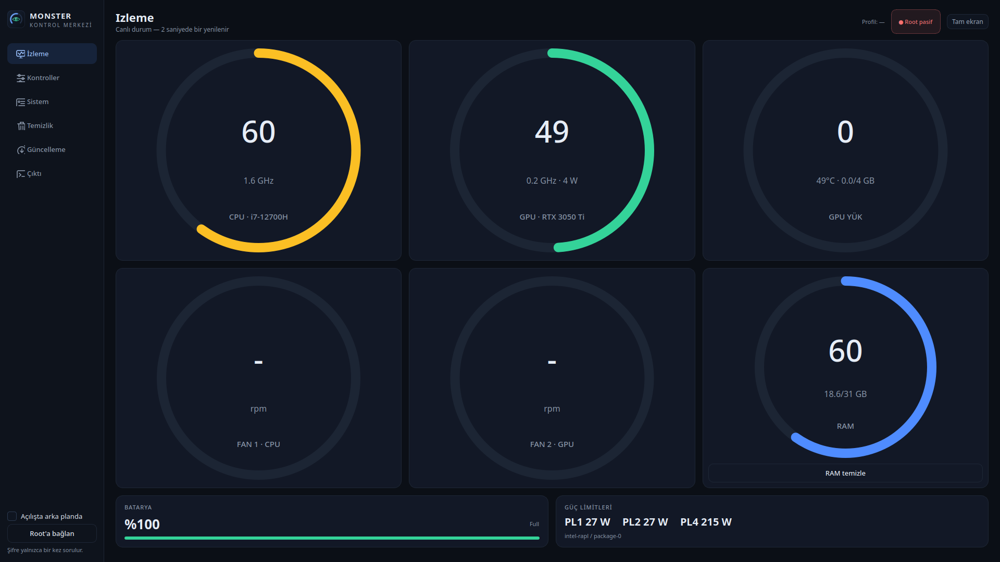
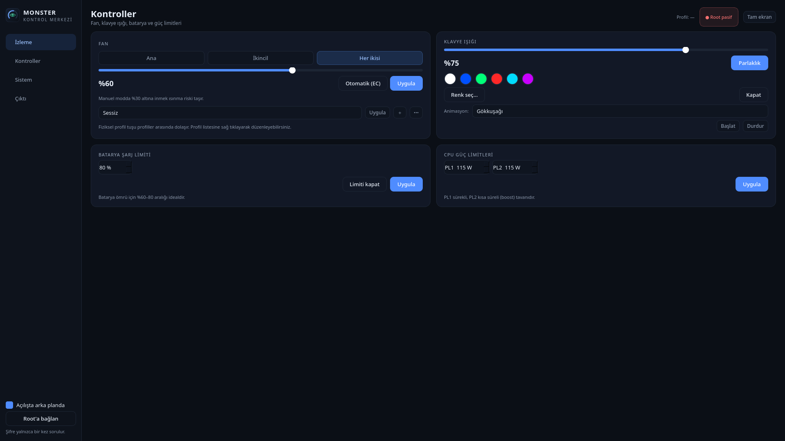

<p align="center">
  
</p>

<h1 align="center">OpenMonster</h1>
<p align="center"><b>Monster / Uniwill laptoplar için Linux kontrol merkezi</b><br>
Fan eğrisi · klavye RGB · batarya limiti · CPU güç limitleri · sistem temizliği</p>

<p align="center">
  
  
  
</p>

OpenMonster, Monster/Abra (Uniwill/Tongfang ODM) laptopları Linux'ta yönetmek için
yazılmış açık kaynak bir kontrol merkezidir. Gerçek donanım (EC/BIOS) üzerinden
çalışır; sanal veya "kaplivada" bir katman değildir. Modern PyQt6 arayüzü ve
`monsterctl` CLI aracı aynı çekirdeği kullanır.



## Özellikler

- **Canlı izleme:** CPU/GPU sıcaklığı, frekans ve güç; NVIDIA GPU yükü/belleği;
  fan devri ve duty; RAM; disk sağlığı/sıcaklığı/okuma-yazma; batarya; PL1/PL2.
- **Fan kontrolü:** EC universal fan tablosu (`0x0F00..0x0F5F`) + doğrudan
  `0x1804` / `0x1809` yazımı. CPU/GPU fanını ayrı ayrı veya birlikte sürme.
- **Fan profilleri:** Sessiz / Dengeli / Performans hazır gelir. Kontroller
  ekranından **＋ Yeni** ile kendi profilinizi (ad + fan % + güç %) ekleyin.
  Profillere sağ tıklayıp düzenleyin/silin. Profiller
  `~/.config/openmonster/profiles.json` içinde saklanır.
- **Sistem tepsisi:** Pencereyi kapatmak uygulamayı kapatmaz; arka planda
  çalışır. Tepsi menüsünden uygulamayı açmadan RAM/sistem temizleyebilir,
  klavye rengi ve animasyonu seçebilir, fan profili uygulayabilirsiniz.
- **Klavye RGB:** Renk seçici + 6 animasyon (gökkuşağı, nefes, kalp atışı,
  ateş, renk geçişi, çakar).
- **Batarya:** Şarj limiti (%10–100 veya kapalı).
- **CPU güç limitleri:** intel-rapl üzerinden PL1/PL2.
- **Sistem temizleyici:** paket önbelleği, journal, sistem önbellekleri, çöp
  kutusu, küçük resimler ve uygulama önbelleği.
- **Tam ekran:** F11 ile tam ekran, Esc ile çıkış. Göstergeler her çözünürlükte
  kartların içinde kalacak şekilde ölçeklenir.
- **Tek şifre:** Açılışta bir kez `pkexec` parolası sorulur; root yardımcı
  süreci oturum boyunca komutları parolasız çalıştırır.



## Kurulum

Hazır paketler [GitHub Releases](https://github.com/talhayksk/openmonster/releases/latest)
sayfasında. Paketler; `/usr/bin/openmonster`, `/usr/bin/monsterctl`, uygulama menü
kaydı, ikonlar, modprobe/modules-load yapılandırması ve isteğe bağlı fan profili
systemd servisini kurar.

### Arch Linux / CachyOS (pacman)

```bash
sudo pacman -U openmonster-1.0.0-1-x86_64.pkg.tar.zst
openmonster
```

AUR paket dosyaları [`packaging/aur`](packaging/aur) altında hazır. AUR hesap
kaydı yeniden açıldığında paket AUR'a gönderilecek:

```bash
yay -S openmonster        # veya paru -S openmonster
```

### Debian / Ubuntu (.deb)

```bash
sudo apt install ./openmonster_1.0.0-1_amd64.deb
openmonster
```

Debian 12 ve Ubuntu 24.04 üzerinde test edildi. Eski `apt` sürümlerinde:

```bash
sudo dpkg -i openmonster_1.0.0-1_amd64.deb
sudo apt -f install
```

### Fedora / RPM tabanlı dağıtımlar (.rpm)

```bash
sudo dnf install ./openmonster-1.0.0-1.fc41.x86_64.rpm
openmonster
```

Fedora 41 üzerinde test edildi. `acpi_call` ve NVIDIA sürücüsü Fedora'da
genellikle RPM Fusion'dan gelir; paket bunları yalnızca önerir, zorunlu tutmaz.

### Diğer dağıtımlar (portable arşiv)

```bash
tar -xzf openmonster-1.0.0-portable-x86_64.tar.gz
cd openmonster-1.0.0-portable
sudo ./install.sh
openmonster
```

Portable arşiv, C yardımcısını statik olarak içerir; Python 3 + PyQt6, PolicyKit
(`pkexec`), `kmod` ve `systemd` sistemde bulunmalıdır. Kaldırmak için aynı
dizinde:

```bash
sudo ./uninstall.sh
```

### Kaynaktan

```bash
git clone https://github.com/talhayksk/openmonster.git
cd openmonster
make
sudo make install
openmonster
```

`make install` varsayılan olarak `/usr` altına kurar. Farklı bir yere kurmak
için `PREFIX` ve `DESTDIR` kullanılabilir.

### Gereksinimler

- Python 3 + PyQt6
- `acpi_call` çekirdek modülü (fan/batarya EC erişimi)
- `uniwill-laptop` çekirdek modülü (`force=1`)
- NVIDIA istatistikleri için NVIDIA sürücüsü (isteğe bağlı)
- Paket önbelleği temizliği için dağıtımın paket yöneticisi araçları (isteğe bağlı)

Dağıtıma göre paket adları:

| Dağıtım | PyQt6 | acpi_call | NVIDIA |
|---|---|---|---|
| Arch / CachyOS | `python-pyqt6` | `acpi_call` | `nvidia-utils` |
| Debian / Ubuntu | `python3-pyqt6` | `acpi-call-dkms` | `nvidia-driver` |
| Fedora | `python3-pyqt6` | `akmod-acpi_call` (RPM Fusion) | `akmod-nvidia` (RPM Fusion) |

Fan profili servisi (boot'ta sıcaklık eğrisine göre fan sürer):

```bash
sudo systemctl enable --now monster-ctrl-fanprofile.service
```

## Arka plan ve sistem tepsisi

- Pencereyi kapattığınızda uygulama tepsiye küçülür ve çalışmaya devam eder.
- Tepsi simgesine **sol tık** pencereyi açar, **sağ tık** hızlı menüyü gösterir.
- Menüden: RAM temizle, sistem temizle, klavye rengi/animasyonu, fan profilleri,
  otomatik EC modu, otomatik başlatma ve çıkış.
- Sol menüdeki **“Açılışta arka planda”** kutusu oturum açılışında tepside
  başlatır (`~/.config/autostart/openmonster.desktop`).

## CLI kullanımı

```bash
sudo monsterctl status                # sabit rapor: sıcaklık, fan, batarya, PL
sudo monsterctl fan <0-100> [--fan main|secondary|both]
sudo monsterctl fan dump              # EC fan tablosunu göster
sudo monsterctl fan diag              # EC teşhis (mod/flag/register)
sudo monsterctl fan auto              # orijinal tabloya dön
sudo monsterctl fan factory           # universal kapat & tabloyu sıfırla
sudo monsterctl fanprofile [--interval 3] [--curve 40:30,50:40,60:55,70:70,80:85,90:100]
sudo monsterctl monitor <sn>
sudo monsterctl battery <10-100|off|status>
sudo monsterctl kbd <0-100|on|off|status>
sudo monsterctl kbd color <R> <G> <B>
sudo monsterctl power status
sudo monsterctl power stat            # anlık CPU paket gücü (W)
sudo monsterctl power pl1 <W> | pl2 <W> | <pl1> <pl2>
sudo monsterctl cleanup ram           # RAM önbelleğini boşalt
sudo monsterctl cleanup journal [MB]  # journal loglarını küçült
sudo monsterctl cleanup pkgcache      # paket önbelleğini temizle
sudo monsterctl cleanup syscache      # debtap/pkgfile/fwupd önbellekleri
monsterctl helper                     # GUI root yardımcısı (doğrudan kullanmayın)
```

## Çalışma mimarisi (GM5AGx / Abra A5 V19.3)

- **EC erişimi:** `acpi_call` + DSDT kapsamı `\_SB.INOU.ECRR/ECRW`.
- **uniwill-laptop çekirdek modülü:** MONSTER DMI whitelist dışında olduğu için
  `force=1` ile yüklenir (`/etc/modprobe.d/monster-ctrl.conf`).
- **Universal fan tablosu:** EC RAM `0x0F00..0x0F5F`, CPU/GPU ayrı iki blok;
  16 adet `[temp_end][temp_start][speed]` girişi. `UNIVERSAL_FAN_CTRL`
  (`0x07C6` bit2) + `SPLIT_TABLES` (`0x07C5` bit7) bayrakları ile etkinleşir.
  Hız yazımı Tuxedo sürücüsüyle aynı: tablo girişi + doğrudan `0x1804` / `0x1809`.
- **Batarya şarj limiti:** EC `0x07B9`, 7-bit yüzde + bit7 "reached".
- **Klavye RGB:** `uniwill:multicolor:kbd_backlight` sysfs; kanallar
  `multi_max_intensity` aralığına otomatik ölçeklenir. Animasyonlar GUI
  zamanlayıcısıyla sürülür.
- **PL1/PL2:** `/sys/class/powercap/intel-rapl:0`.
- **Fiziksel profil tuşu:** Uniwill WMI `KEY_F6` → Sessiz/Dengeli/Performans
  döngüsü (root yardımcısı dinler).

## Paket üretme

```bash
./scripts/build-package.sh          # Arch paketi + sha256
./scripts/build-deb.sh              # Debian/Ubuntu .deb
./scripts/build-rpm.sh              # Fedora .rpm
./scripts/build-portable.sh         # Tüm dağıtımlar için portable tar.gz
```

`.deb`, `.rpm` ve portable arşiv, hedef dağıtımın konteynerinde derlenir
(`debian:12`, `fedora:41`); böylece C yardımcısı eski glibc sürümleriyle uyumlu
kalır. Gereksinim: `podman` veya `docker`. Çıktılar `dist/` altına yazılır.

AUR paketini yerelde denemek için:

```bash
cd packaging/aur
makepkg -si
```

Sürüm etiketi yayınlandığında `.github/workflows/packages.yml` üç paketi
otomatik derleyip release'e ekler. Manuel çalıştırma için GitHub Actions
üzerinden **Linux packages → Run workflow** kullanılabilir.

## Yol haritası

- [x] M1: Fan kontrolü (EC universal tablo + CPU/GPU ayrımı), sıcaklık
- [x] M1.5: Klavye RGB (renk/parlaklık)
- [x] M1.6: Batarya şarj limiti
- [x] M1.7: CPU PL1/PL2 (intel-rapl)
- [x] M2: Sıcaklık eğrisi fan profili servisi
- [x] M2.5: Fiziksel profil tuşu, zengin izleme
- [x] M3: RGB efektleri + serbest renk seçici
- [x] M5: Sistem tepsisi, arka plan, özel fan profilleri, paketleme
- [ ] M6: TUI panel ve değişken WIN kısayolları

## Lisans

[GPL-3.0-or-later](LICENSE). Bu proje Monster/Uniwill ile resmî bir bağlantıya
sahip değildir; marka adları yalnızca uyumluluk bilgisi için kullanılmıştır.
